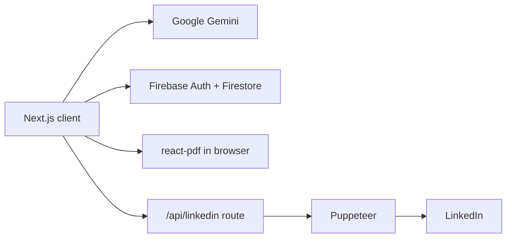

<div align="center">

# CVSpark

A resume builder that uses Google Gemini to tailor your resume to a job description and exports the result as a PDF.


</div>

## Overview

CVSpark helps you send a resume that fits each application. You enter your experience, education, projects and skills once. Then you paste a job description, or pull one from LinkedIn, and Gemini rewrites your resume around that role's skills and keywords. The page shows a live PDF preview that you can restyle and download. Signed-in users can save their resume to Firestore and reuse it as their default.

## Features

- **Structured resume editor**: Forms for personal info, experience, education, projects and skills, with date pickers. Drafts are saved in `localStorage` as you type.
- **AI tailoring**: `generateTailoredContent` sends your resume data and the job description to Gemini, which returns a rewritten resume as JSON based on the role's skills, responsibilities and keywords.
- **Live PDF preview and export**: Built with `@react-pdf/renderer` and the bundled Carlito font, and downloaded as `resume.pdf`.
- **Layout tools**: Adjust the font, font size, colors and margins of the generated PDF.
- **Default resume**: Save a resume as your default and turn on "Use Default Resume" when generating.
- **Accounts and cloud save**: Firebase email/password sign-up and login. Resumes are saved to `users/{uid}/resumes/default` and protected by the Firestore rules in `firestore.rules`.
- **LinkedIn helper**: `POST /api/linkedin` opens a visible Puppeteer browser. You log in to LinkedIn yourself, then the route can search jobs (`searchJobs`) or fetch a job description by URL (`getDescription`).
- **Onboarding, landing page and dark mode**: An onboarding flow for new users, a marketing landing page, and light/dark themes with `next-themes`.

## Tech stack

| Layer | Technology |
|-------|------------|
| Framework | Next.js 14 (App Router), React 18, TypeScript |
| UI | Tailwind CSS, shadcn/ui (Radix primitives), lucide-react, Framer Motion, react-hot-toast |
| Forms | react-hook-form, zod, react-datepicker, react-day-picker |
| AI | Google Gemini via `@google/generative-ai` (`gemini-pro`) |
| PDF | `@react-pdf/renderer`, file-saver |
| Auth and data | Firebase Authentication, Cloud Firestore |
| Automation | Puppeteer (LinkedIn job search and description scraping) |

## Architecture



## Project structure

```
CVSpark/
├── app/
│   ├── (auth)/(routes)/            # login, signup
│   ├── (dashboard)/(routes)/
│   │   ├── page.tsx                # Landing page
│   │   ├── onboarding/             # First-run resume setup
│   │   ├── generate/               # Job description -> tailored resume
│   │   └── resume/                 # Editor + components (MyDocument, LayoutTools, job-search, ...)
│   └── api/linkedin/route.ts       # Puppeteer job search / description fetch
├── components/                     # Navbar, route guard, theme provider, shadcn/ui
├── context/global-context.tsx      # Resume state, layout settings, Firestore save/load
├── lib/
│   ├── firebase.ts                 # Firebase app, auth, Firestore
│   └── gemini-service.ts           # Tailoring prompt + JSON parsing
├── fonts/                          # Carlito Regular/Bold
├── firestore.rules
└── public/images/
```

## Getting started

### Prerequisites

- Node.js 18+
- A Firebase project with Email/Password auth and Firestore enabled
- A Gemini API key from Google AI Studio
- Chrome or Chromium for Puppeteer, if you want to use the LinkedIn helper

### Install and run

```bash
git clone https://github.com/abhiishek340/CVSpark.git
cd CVSpark
npm install
npm run dev        # http://localhost:3000
```

Other scripts: `npm run build`, `npm start` and `npm run lint`.

### Configuration

| Variable | Description |
|----------|-------------|
| `NEXT_PUBLIC_GEMINI_API_KEY` | Gemini API key, read in `lib/gemini-service.ts` |

The Firebase web config is set directly in `lib/firebase.ts`, not through environment variables. Replace it with your own project's config, and deploy `firestore.rules` to your project.

## Limitations

- **Key in the browser**: The Gemini call runs in the browser, so the `NEXT_PUBLIC_` key ships in the client bundle. Move it to a server route before a public deployment.
- **Retired model**: `gemini-pro` has been retired by Google. Update the model ID in `lib/gemini-service.ts` to a current Gemini model.
- **LinkedIn helper is local only**: It runs a visible (non-headless) browser and waits for you to log in by hand. The UI also calls an `applyToJob` action that the route does not implement yet. Automating LinkedIn may break its terms of use.
- **Leftover names**: The landing page still uses an earlier name ("FutureFit"), and the package is named `black-marker`.

## Acknowledgments

[Next.js](https://nextjs.org/), [Firebase](https://firebase.google.com/), [shadcn/ui](https://ui.shadcn.com/), [React-PDF](https://react-pdf.org/), and the [Carlito](https://fonts.google.com/specimen/Carlito) font.

---

Built by [Abhishek Yadav](https://github.com/abhiishek340)
